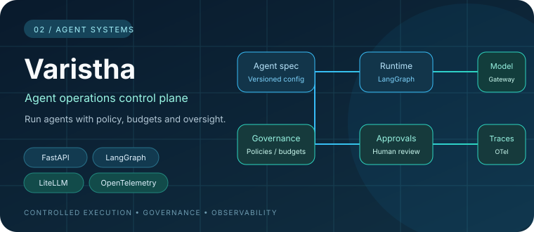
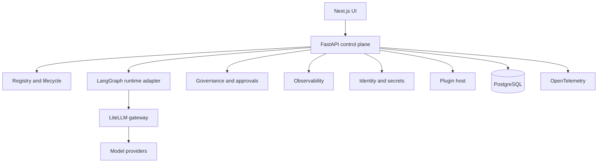

<div align="center">



</div>

# Varistha

<p>
  
  <a href="https://github.com/SSRINIBASS/varistha/actions/workflows/ci.yml"></a>
  
  
</p>

<p>
  <a href="https://skillicons.dev"></a>
</p>

**An open-source control-plane prototype for building, executing, governing, and observing AI agents.**

Varistha explores the application infrastructure around AI agents: versioned agent specifications, controlled execution, policy enforcement, human approvals, evaluation, identity, and trace-level observability.

> **Project status:** Active development. The repository contains working API, runtime, governance, observability, identity, plugin-host, and UI components. It is not yet presented as a production-certified or high-availability platform.

## 🏗️ Architecture



## 🧩 Implemented areas

### Agent registry and lifecycle
Versioned agent specifications, schema validation, revision comparison, lifecycle transitions, and promotion gates.

### Runtime integration
A LangGraph-backed runtime adapter invokes models through LiteLLM, records token and cost metadata, and returns structured run outcomes.

### Governance
Policy evaluation, approval workflows, guardrails, and runtime budget checks. Approval decisions are handled by application services rather than relying solely on model instructions.

### Evaluation
Built-in evaluators, evaluation records, and comparison utilities for examining agent outputs and regressions.

### Observability
OpenTelemetry instrumentation for model calls, token usage, cost, execution status, and domain-specific agent attributes.

### Identity and extensibility
JWT-based identity, API-key handling, encrypted secret storage, and a plugin-host interface.

## 🧰 Technology

| Layer | Technology |
|---|---|
| API | Python, FastAPI |
| Runtime | LangGraph, LiteLLM |
| UI | Next.js, TypeScript |
| Persistence | PostgreSQL, SQLAlchemy, Alembic |
| Observability | OpenTelemetry |
| Testing and quality | pytest, Ruff, Pyright, Bandit, pip-audit |
| Development and deployment | uv workspace, Docker Compose, GitHub Actions |

## ✅ Quality gates

The GitHub Actions CI workflow checks:

- Python linting and formatting
- Strict Pyright type checking
- Python tests with an 80% minimum coverage threshold
- Bandit security scanning and dependency auditing
- Architecture-boundary checks
- Frontend linting, type checking, and tests

These are automated repository checks, not a substitute for an independent security assessment or production load testing.

## 🚀 Quick start

### Prerequisites

- Python 3.12
- uv
- Docker Engine and Docker Compose
- Node.js and pnpm for UI development

### Start the core services

```bash
git clone https://github.com/SSRINIBASS/varistha.git
cd varistha

cp deploy/.env.example deploy/.env
# Review deploy/.env and replace all example secrets.

docker compose -f deploy/docker-compose.yml up -d
```

The default local endpoints are:

- Dashboard: [http://localhost:3000](http://localhost:3000)
- API documentation: [http://localhost:8000/docs](http://localhost:8000/docs)
- Health endpoint: [http://localhost:8000/health](http://localhost:8000/health)

See the [Quickstart guide](docs/guides/quickstart.md) for the current development workflow.

## 📁 Repository structure

```text
apps/
  api/       FastAPI application and domain modules
  worker/    Background worker package (under development)
  ui/        Next.js interface
packages/
  cli/       Command-line interface
  spec/      Agent specification models and validation
  sdk/       Python SDK
plugins/     Built-in tool integrations
deploy/      Docker Compose and deployment configuration
docs/        Guides, runbooks, architecture and security notes
```

## 🔐 Development status and security

Varistha is evolving quickly. Runtime orchestration, worker deployment, integrations, and operational hardening require further validation before production use. Review the [threat model](docs/security/threat-model.md), use unique local secrets, and do not expose an unreviewed development deployment to the public internet.

Contributions and technical feedback are welcome. See [CONTRIBUTING.md](CONTRIBUTING.md).

## 📄 License

Apache License 2.0 — see [LICENSE](LICENSE).
